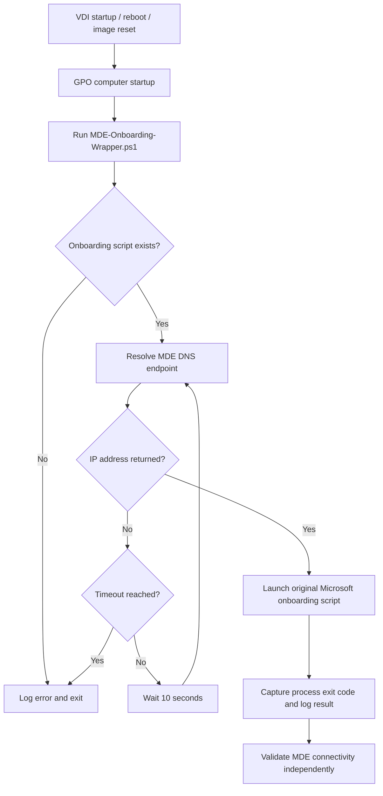

# Microsoft Defender for Endpoint – Non-Persistent VDI Onboarding Wrapper


A PowerShell startup wrapper for Microsoft Defender for Endpoint (MDE) that waits for DNS resolution to become available before executing Microsoft's non-persistent VDI onboarding script.

Designed to be VDI platform-agnostic and suitable for any supported Windows non-persistent VDI environment that uses Microsoft's non-persistent onboarding script, including Citrix DaaS, Azure Virtual Desktop, Omnissa Horizon and other VDI platforms.

Originally developed to address onboarding and connectivity issues observed with Citrix DaaS session hosts following platform-initiated reboots and image resets. The wrapper has no Citrix-specific dependencies and is expected to work in equivalent VDI scenarios, although testing to date has been limited to Citrix DaaS.

## Table of contents

- [Background](#background)
- [The solution](#the-solution)
- [How it works](#how-it-works)
- [Features](#features)
- [Prerequisites](#prerequisites)
- [Deployment via Group Policy](#deployment-via-group-policy)
- [Configuration](#configuration)
- [Logging and validation](#logging-and-validation)
- [Troubleshooting](#troubleshooting)
- [Testing and limitations](#testing-and-limitations)
- [Rollback](#rollback)
- [References](#references)

## Background

When onboarding non-persistent Citrix DaaS session hosts to Microsoft Defender for Endpoint, an issue was observed where devices failed to establish normal connectivity to the MDE cloud service following a Citrix platform-initiated reboot.

The affected environment used Windows Server 2022 session hosts, non-persistent images and Microsoft's `Onboard-NonPersistentMachine.ps1` script deployed via Group Policy. The master image itself was not onboarded to MDE.

The following symptoms were observed:

- Devices failed to check in normally to the Microsoft Defender portal following a Citrix DaaS reboot or image reset.
- The SENSE operational log recorded recurring connectivity or authentication errors, including Event IDs 405 and 406.
- HTTP error code `12007` was recorded alongside HRESULT `0x8000FFFF`.
- The expected cloud configuration (Event ID 50) was not received until an in-OS reboot was performed.
- Restarting the operating system directly restored MDE connectivity, whereas restarting through the Citrix platform could reproduce the issue.

An example of the error observed:

```text
Failed to communicate with authentication service.
Register request failed, hresult: 0x8000FFFF, HTTP error code: 12007.
```

HTTP error code `12007` indicates that a server name could not be resolved. Following discussions with Microsoft Support, a potential startup timing issue was investigated: the onboarding script might be executing before DNS resolution was available.

> [!NOTE]
> Event IDs 405 and 406 can occur during normal MDE operation. Their presence alone does not establish an onboarding failure. In this case, the concern was their correlation with persistent connectivity issues and the absence of cloud configuration retrieval.

## The solution

Rather than executing the Microsoft onboarding script directly at computer startup, a wrapper script first checks whether a specified MDE cloud endpoint can be resolved using DNS.

Once DNS resolution succeeds and an IP address is returned, the wrapper launches the original Microsoft onboarding script.

This provides a condition-based readiness check instead of relying on an arbitrary fixed startup delay. The original Microsoft onboarding files remain unchanged.

The approach was suggested by Microsoft Support and was subsequently tested successfully in the affected Citrix DaaS environment.

## How it works



The default DNS endpoint is:

```text
edr-weu.eu.endpoint.security.microsoft.com
```

This is the endpoint used in the original investigation. Confirm that the configured endpoint is appropriate for your MDE environment and connectivity configuration before deployment.

## Features

- DNS readiness validation using `Resolve-DnsName`.
- Configurable retry interval and DNS timeout.
- Requires a DNS response containing at least one IP address.
- Preserves the original Microsoft onboarding files without modification.
- Executes the onboarding script in a separate Windows PowerShell process and captures its exit code.
- Automatically locates the onboarding script relative to the wrapper.
- Timestamped local logging for troubleshooting and support investigations.
- Compatible with Group Policy computer startup script deployment.
- Platform-agnostic design with no dependencies on Citrix or other VDI vendor tooling.
- Stops without attempting onboarding if DNS resolution does not succeed within the configured retry window.

## Prerequisites

- An appropriately licensed and configured Microsoft Defender for Endpoint environment.
- A supported Windows operating system with Windows PowerShell 5.1 and `Resolve-DnsName` available.
- Microsoft's non-persistent VDI onboarding package downloaded from your own Microsoft Defender portal.
- Permissions to configure Group Policy computer startup scripts.
- Required DNS, network and MDE service connectivity.
- PowerShell execution policies and application control policies that permit both scripts to run.

Obtain the Microsoft onboarding package from the Defender portal under **Settings > Endpoints > Onboarding**, selecting the appropriate operating system and non-persistent VDI deployment option where available.

> [!IMPORTANT]
> Do not upload your tenant-specific Microsoft onboarding package to a public GitHub repository. Obtain the original onboarding files directly from your own Defender portal. For non-persistent VDI, follow Microsoft's guidance on preparing the master image without onboarding it.

## Deployment via Group Policy

### 1. Open the onboarding GPO

Open Group Policy Management and edit your existing MDE onboarding GPO, or create a dedicated test GPO scoped to a pilot session host.

Navigate to:

```text
Computer Configuration
  Policies
    Windows Settings
      Scripts (Startup/Shutdown)
        Startup
```

Select the **PowerShell Scripts** tab and click **Show Files**.

### 2. Copy the wrapper script

Place `MDE-Onboarding-Wrapper.ps1` alongside the original Microsoft onboarding files in the GPO startup script folder.

The folder should contain:

```text
Startup/
├── MDE-Onboarding-Wrapper.ps1
├── Onboard-NonPersistentMachine.ps1
└── WindowsDefenderATPOnboardingScript.cmd
```

The two Microsoft onboarding files are supplied by Microsoft, not by this project.

### 3. Update the startup script configuration

Remove the existing `Onboard-NonPersistentMachine.ps1` entry from the list of configured startup scripts, but **do not delete the file** from the startup script folder.

Add the wrapper with the following configuration:

| Setting | Value |
| --- | --- |
| Script name | `MDE-Onboarding-Wrapper.ps1` |
| Script parameters | None |
| Script type | PowerShell computer startup script |
| Execution context | Local System (`NT AUTHORITY\SYSTEM`) |
| Trigger | Computer startup |

> [!IMPORTANT]
> The wrapper must be the only entry responsible for launching MDE onboarding. Do not independently configure the original PowerShell script or CMD file to run at startup, as this would bypass the DNS readiness check.

### 4. Check the Group Policy script timeout

Review the following policy:

```text
Computer Configuration
  Policies
    Administrative Templates
      System
        Scripts
          Specify maximum wait time for Group Policy scripts
```

The default maximum wait time is 600 seconds (10 minutes). Ensure sufficient time is available for the DNS retry window, the Microsoft onboarding process and any other applicable Group Policy scripts.

### 5. Apply and test

Allow time for Group Policy and SYSVOL replication, then refresh policy on the pilot session host:

```powershell
gpupdate /target:computer /force
```

Perform a reboot or image reset through your **VDI management platform** (for example, the Citrix DaaS console) to reproduce the affected startup conditions. A Group Policy refresh alone does not execute computer startup scripts.

Validate the results before expanding deployment to additional session hosts.

## Configuration

The following variables can be modified at the beginning of the wrapper script:

```powershell
$DnsName = "edr-weu.eu.endpoint.security.microsoft.com"
$RetryInterval = 10
$TimeoutSeconds = 300
$OnboardingScript = Join-Path $PSScriptRoot "Onboard-NonPersistentMachine.ps1"
$LogDirectory = "C:\ProgramData\MDEOnboarding"
$LogFile = Join-Path $LogDirectory "Onboarding-Wrapper.log"
```

| Variable | Default | Description |
| --- | --- | --- |
| `$DnsName` | `edr-weu.eu.endpoint.security.microsoft.com` | DNS endpoint to resolve before onboarding. |
| `$RetryInterval` | `10` | Seconds to wait between unsuccessful DNS attempts. |
| `$TimeoutSeconds` | `300` | Approximate maximum DNS retry window, in seconds. |
| `$OnboardingScript` | Original script in the wrapper's directory | Path to the Microsoft onboarding script. |
| `$LogDirectory` | `C:\ProgramData\MDEOnboarding` | Directory used for local logging. |
| `$LogFile` | `Onboarding-Wrapper.log` | Log file within the configured directory. |

The retry window is approximate because DNS queries and the final sleep can extend execution beyond the configured threshold. It does not include the execution time of the Microsoft onboarding script.

## Logging and validation

### Wrapper log

The wrapper creates its log at:

```text
C:\ProgramData\MDEOnboarding\Onboarding-Wrapper.log
```

To retrieve the log:

```powershell
Get-Content 'C:\ProgramData\MDEOnboarding\Onboarding-Wrapper.log'
```

To monitor the log in real time:

```powershell
Get-Content 'C:\ProgramData\MDEOnboarding\Onboarding-Wrapper.log' -Wait
```

Example output (illustrative, not captured from a production device):

```text
2026-01-01 08:00:01 - MDE onboarding wrapper started.
2026-01-01 08:00:01 - Execution account: NT AUTHORITY\SYSTEM
2026-01-01 08:00:01 - DNS target: edr-weu.eu.endpoint.security.microsoft.com
2026-01-01 08:00:02 - DNS attempt 1 failed: DNS operation timed out.
2026-01-01 08:00:13 - DNS resolution successful on attempt 2.
2026-01-01 08:00:13 - DNS became available after 12 seconds.
2026-01-01 08:00:13 - Starting Microsoft MDE onboarding script.
2026-01-01 08:00:21 - Onboarding script exited with code: 0
2026-01-01 08:00:21 - MDE onboarding script execution completed.
2026-01-01 08:00:21 - MDE onboarding wrapper finished.
```

The actual log also records the computer name and resolved IP addresses.

### SENSE operational events

Use the following command to retrieve relevant MDE operational events generated since the last operating system boot:

```powershell
$LastBoot = (Get-CimInstance Win32_OperatingSystem).LastBootUpTime

Get-WinEvent -FilterHashtable @{
    LogName   = 'Microsoft-Windows-SENSE/Operational'
    StartTime = $LastBoot
    Id        = 50, 405, 406, 419
} -ErrorAction SilentlyContinue |
    Sort-Object TimeCreated |
    Format-List TimeCreated, Id, Message
```

Correlate these events with timestamps in the wrapper log.

### Validate MDE connectivity

- Confirm that the wrapper ran under the Local System account.
- Confirm that DNS resolution succeeded and the original onboarding script was executed.
- Review the onboarding process exit code and the SENSE operational log.
- Check for receipt of the MDE cloud configuration (Event ID 50, where applicable).
- Confirm recent device activity in the Microsoft Defender portal.
- Where appropriate, verify that a remote antivirus scan initiated from the portal reaches the device.
- Repeat testing across platform-initiated VDI reboots or image resets without requiring an in-OS reboot.

> [!WARNING]
> Local logs may be discarded during the next non-persistent image reset. Collect the logs before rebooting again, or arrange secure central log collection.

## Troubleshooting

| Symptom | Recommended investigation |
| --- | --- |
| No wrapper log is created | Check GPO scope, SYSVOL access, startup script configuration, execution policy and local filesystem permissions. |
| Original onboarding script not found | Confirm that the Microsoft PowerShell script is present alongside the wrapper and that the filename matches. |
| DNS resolution repeatedly fails | Investigate DNS servers, network readiness, routing and the suitability of the configured endpoint. |
| DNS resolves but onboarding returns a non-zero exit code | Review Microsoft onboarding diagnostics, execution policies and the original package. |
| DNS resolves and the process exits successfully, but MDE remains disconnected | Investigate HTTPS connectivity, proxy configuration, firewall rules, SENSE events and MDE client analyser results. |
| Wrapper is terminated before completion | Review the Group Policy maximum script execution time and other startup scripts. |
| Connectivity problems return after subsequent VDI reboots | Collect logs from affected boots and investigate image reset behaviour and other startup dependencies. |

## Testing and limitations

The wrapper has been tested successfully in a Citrix DaaS environment with non-persistent Windows Server 2022 session hosts.

The wrapper uses standard Windows PowerShell and DNS functionality and does not interact with any VDI-specific APIs or services. It is therefore expected to work with any supported Windows non-persistent VDI deployment that uses the same Microsoft onboarding package, provided the startup mechanism runs under the appropriate system context. This includes platforms such as Azure Virtual Desktop and Omnissa Horizon when configured for this onboarding method.

These additional platforms have not been independently tested. Validate the wrapper against your own VDI provisioning model, operating system and startup sequence before production deployment. Persistent VDI environments using a different onboarding method are outside the scope of this wrapper as supplied.

- Successful DNS resolution does not guarantee TCP 443, TLS or MDE cloud service connectivity.
- DNS answers may be cached; this is a name-resolution readiness check, not a comprehensive network health test.
- A zero process exit code does not independently confirm successful MDE onboarding or cloud check-in.
- The wrapper does not restart the SENSE service, modify the registry, change firewall rules or alter the Microsoft onboarding package.
- The wrapper intentionally skips onboarding for that startup if DNS resolution does not succeed. It does not schedule a separate retry after exiting.
- The wrapper can extend startup script execution time, particularly when DNS is unavailable.
- Successful testing supports the startup timing hypothesis but does not conclusively establish the underlying root cause.

This is a community-developed utility based on an approach suggested by Microsoft Support. It is not an official Microsoft or Citrix product and carries no implied vendor endorsement.

## Rollback

To revert to the original onboarding configuration:

1. Remove `MDE-Onboarding-Wrapper.ps1` from the GPO startup script entries.
2. Re-add `Onboard-NonPersistentMachine.ps1` as the original PowerShell startup script.
3. Retain the original Microsoft onboarding files in their existing location.
4. Allow policy replication and refresh Group Policy on the affected hosts.
5. Perform a controlled reboot and validate MDE connectivity.

Removing the wrapper does not offboard a device from Microsoft Defender for Endpoint.

## References

- [Onboard non-persistent VDI devices to Microsoft Defender for Endpoint](https://learn.microsoft.com/en-us/defender-endpoint/configure-endpoints-vdi)
- [Troubleshoot Microsoft Defender for Endpoint onboarding issues](https://learn.microsoft.com/en-us/defender-endpoint/troubleshoot-onboarding)
- [Configure device connectivity for Microsoft Defender for Endpoint](https://learn.microsoft.com/en-us/defender-endpoint/configure-device-connectivity)
- [Microsoft Defender for Endpoint client analyser](https://learn.microsoft.com/en-us/defender-endpoint/overview-client-analyzer)
- [Resolve-DnsName PowerShell documentation](https://learn.microsoft.com/en-us/powershell/module/dnsclient/resolve-dnsname)
- [WinHTTP error messages](https://learn.microsoft.com/en-us/windows/win32/winhttp/error-messages)

## Author

Nathan Hutchinson

- GitHub: [NateHutch365](https://github.com/NateHutch365)
- Blog: [natehutchinson.co.uk](https://natehutchinson.co.uk)
